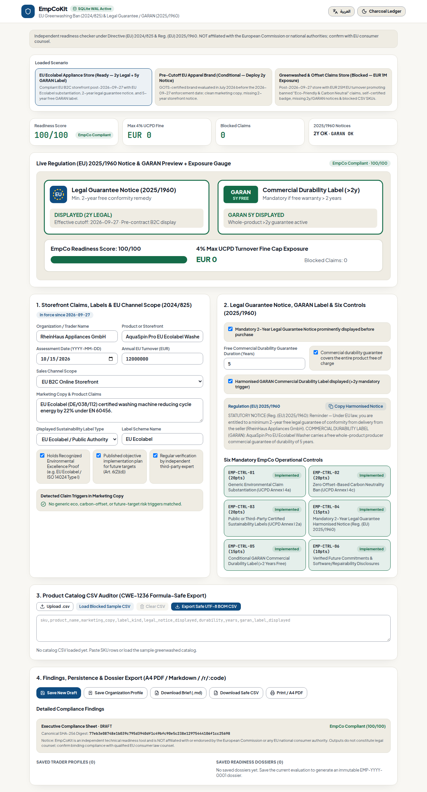
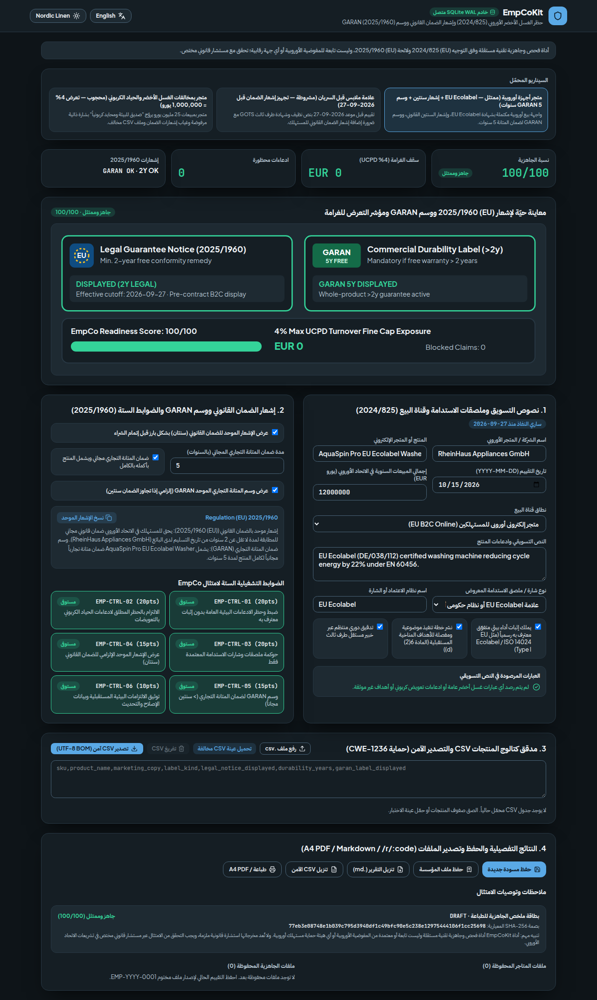
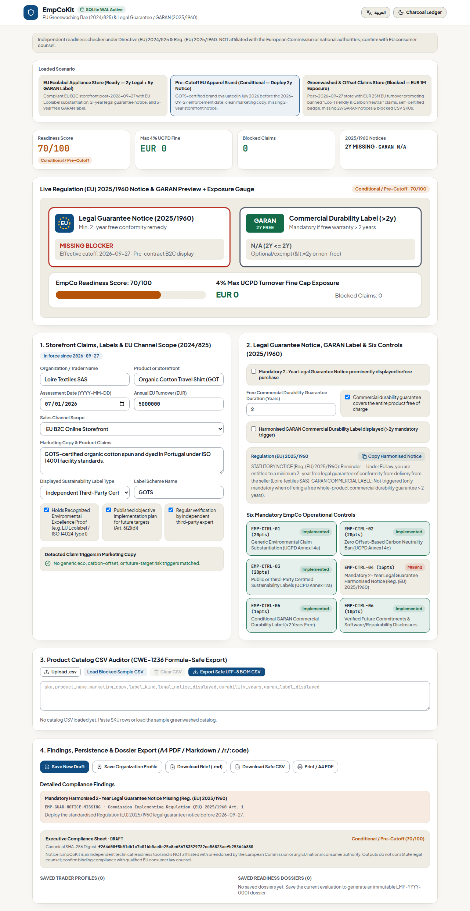
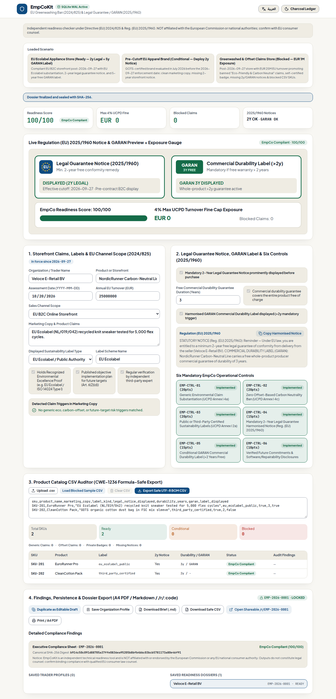
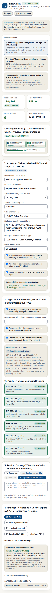
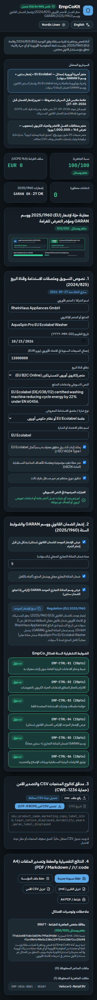

# EmpCoKit — EU EmpCo (`Directive (EU) 2024/825`) & Guarantee Label (`Reg. (EU) 2025/1960`) Auditor

[](LICENSE)

> **Bilingual (`EN LTR` `Nordic Linen` Light & `AR RTL` `Charcoal Ledger` Dark) · Dual-Mode (`SQLite WAL` or `$0` Browser Static Mode)**

> **Mandatory Disclaimer**: EmpCoKit is an independent open-source technical readiness tool and is **NOT** affiliated with or endorsed by the European Commission or any EU national consumer authority. Outputs do not constitute legal advice; confirm binding compliance with qualified EU consumer law counsel.

Built with **React 19, Vite, Tailwind v4**, and an optional zero-dependency **Node 22 + `node:sqlite WAL`** backend.

---

## Regulatory Coverage (Effective `2026-09-27`)
1. **Unproven Generic Environmental Claims (`UCPD Annex I point 4a`)** — Flags vague terms (`eco-friendly`, `green`, `sustainable`, `biodegradable`, `nature's friend`, etc. and Arabic equivalents) unless backed by recognized excellence proof such as **EU Ecolabel** or certified ISO 14024 Type I schemes.
2. **Unconditional Ban on Carbon-Offset Neutrality Claims (`UCPD Annex I point 4c`)** — Blocks product claims such as *carbon neutral*, *climate neutral*, *CO2 neutral*, or *climate compensated* grounded in external GHG offset credits.
3. **Sustainability Labels Governance (`UCPD Annex I point 2a`)** — Flags self-certified private badges (`self_certified_private`) not issued by public authorities or independent third-party certification schemes.
4. **Verified Future Climate Commitments (`UCPD Art. 6(2)(d)`)** — Checks whether public objective implementation plans and regular third-party verification are declared.
5. **Mandatory 2-Year Legal Guarantee Notice & Conditional `GARAN` Label (`Reg. (EU) 2025/1960`)** — Generates harmonised pre-contractual B2C notices and validates conditional whole-product free commercial durability labels (`GARAN`) for guarantees `> 2 years`.
6. **Batch SKU Catalog CSV Audit (`CWE-1236 Safe`)** — Audits multi-SKU product sheets and exports **`UTF-8 BOM`** (`EF BB BF`) CSVs with spreadsheet formula-prefix sanitization.

---

## Visual Showcase (`EN LTR` & `AR RTL`)

### Desktop English LTR (`Nordic Linen` Light — EU Ecolabel & `GARAN` 5Y Ready)


### Desktop Arabic RTL (`Charcoal Ledger` Dark)


### Pre-Cutoff Apparel Brand Conditional Assessment (Pre-`2026-09-27`)


### Remediated Catalog CSV & Sealed `EMP-2026-0001` Dossier (`SHA-256`)


### Mobile English LTR View (`390x844`)


### Mobile Arabic RTL View (`Charcoal Ledger`, `390x844`)


---

## Architecture & `$0` Operation
- **Dual Mode**: Works standalone in browsers (`$0` static hosting via Cloudflare Workers Static Assets with `localStorage`) OR backed by Node 22 (`node:http` + `node:sqlite WAL`) for atomic dossier stamping (`EMP-YYYY-0001`), immutable `409` locks, Markdown/CSV exports, and shareable `/r/:slugOrCode` reports.
- **Canonical `SHA-256` Digest**: Deterministic dossier fingerprint (`Web Crypto` / `node:crypto`).

---

## Quick Start

```bash
npm ci
npm run typecheck
npm test        # Core & Node 22 SQLite WAL server tests (12 tests)
npm run build   # Builds static bundle into ./dist
npm start       # Serves API + React UI on http://127.0.0.1:4221
```

### Zero-Server Static Deploy (`$0` Cloudflare Workers Static Assets)
```bash
npm run build
npx wrangler deploy
```

### Playwright Chrome E2E Verification
```bash
npm run test:e2e
```

Default HTTP server binds to `127.0.0.1:4221` (configurable via `PORT`, `HOST`, `BASE_PATH`, `EMPCOKIT_DATA_DIR`, `APP_ORIGIN`).
See [launch/DEPLOY-AND-SHARE.md](launch/DEPLOY-AND-SHARE.md) for `$0` Cloudflare Workers, Docker Compose, Caddy, and Systemd deployment recipes.

---

## License

Released under the [MIT License](LICENSE).
